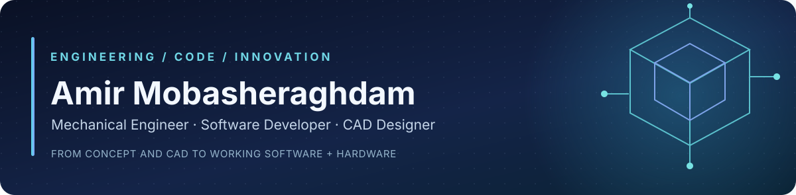
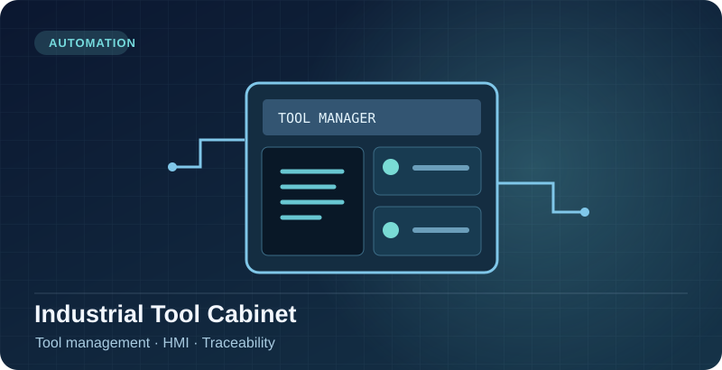
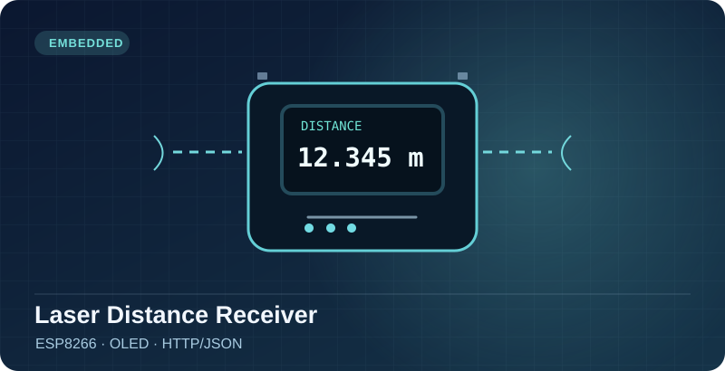
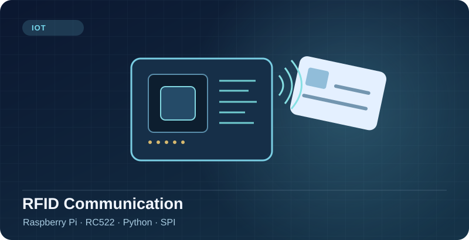
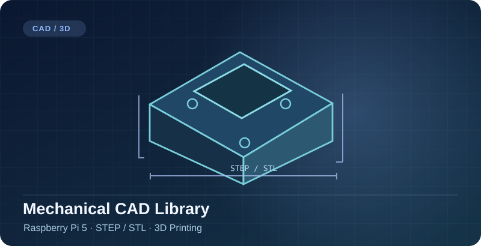

  

Amir Mobasheraghdam

  <a href="https://amirmobasher.ir">Portfolio</a> ·
  <a href="https://www.linkedin.com/in/amirmobasher/">LinkedIn</a> ·
  <a href="https://cults3d.com/fr/utilisateurs/AmirMobasheraghdam/fichiers-3d">3D Designs</a> ·
  <a href="https://www.myminifactory.com/users/AmirMobasher">MyMiniFactory</a> ·
  <a href="PORTFOLIO_FULL.md">Full profile / Vollständiges Profil</a>

## Hello / Hallo! 👋

**EN** · I'm **Amir Mobasheraghdam** (also **Amir Mobasher** / `Amirmobash`), a mechanical engineer, technical author and developer. I build practical prototypes that connect **CAD, Python, embedded hardware, machine learning and industrial automation**.

**DE** · Ich verbinde **Maschinenbau, CAD-Konstruktion, Programmierung und Elektronik** zu praxisnahen Prototypen — von der Idee bis zum testbaren System.

📍 **Cologne–Bonn, Germany** · **Core tools / Technologien:** Python · C++ · Raspberry Pi · Arduino · ESP8266 · RFID · OpenCV · SolidWorks · Siemens NX · STEP / STL · n8n

## Selected projects / Ausgewählte Projekte

<table>
<tr>
<td width="50%" valign="top">
 
<strong>LROX — AI-assisted Smart Helmet</strong> 
Bicycle-safety innovation concept using intelligent sensing; recognised at the University of Bonn's 2025 Ideas Competition. 
AI · Sensors · Prototyping · <a href="https://www.uni-bonn.de/en/news/ideas-with-passion-and-entrepreneurial-spirit">Award</a>
</td>
<td width="50%" valign="top">
 
<strong>Industrial Tool Cabinet / Werkzeugschrank</strong> 
Digital tool-management concept for shop-floor workflows, identification and traceability. 
Industrial Software · HMI · Automation · <a href="https://github.com/Amirmobash/Werkzeugschrank">Code</a>
</td>
</tr>
<tr>
<td width="50%" valign="top">
 
<strong>Laser Distance Receiver / Laser-Distanzempfänger</strong> 
ESP8266 receiver for distance data over HTTP/JSON, displayed on an I²C OLED. 
ESP8266 · C++ · OLED · <a href="https://github.com/Amirmobash/Receiver_ESP8266">Code</a>
</td>
<td width="50%" valign="top">
 
<strong>RFID Communication / RFID-Kommunikation</strong> 
Raspberry Pi and RC522 experiments and Python integration through SPI. 
Python · Raspberry Pi · RFID · SPI · <a href="https://github.com/Amirmobash/RFID-Kommunikation">Code</a>
</td>
</tr>
<tr>
<td width="50%" valign="top">
 
<strong>CableCarousel</strong> 
Python/CustomTkinter desktop UI with cable-reel selection and Arduino communication. 
Python · CustomTkinter · PySerial · <a href="https://github.com/Amirmobash/CableCarousel">Code</a>
</td>
<td width="50%" valign="top">
 
<strong>CAD & 3D Design / CAD-Konstruktion</strong> 
Reference models for Raspberry Pi 5, sensors, housings and 3D-printable components. 
SolidWorks · Siemens NX · STEP / STL · <a href="https://github.com/Amirmobash/Design-Files-Raspberry-Pi-5">Files</a>
</td>
</tr>
</table>

**More work / Weitere Projekte:** [Bidirectional Counter](https://github.com/Amirmobash/bidirectional-counter) · [LROX Sensor CAD](https://github.com/Amirmobash/LROX-STEP) · [musterteil.de](https://github.com/Amirmobash/musterteil.de) · [mailsignal](https://github.com/Amirmobash/mailsignal) · [WebAppDesktopLauncher](https://github.com/Amirmobash/WebAppDesktopLauncher) · [All repositories](https://github.com/Amirmobash?tab=repositories)

## Recognition & publications / Auszeichnung & Bücher

🏆 **LROX Smart Helmet** — **Comma Soft AG award (€1,000)** at the **2025 University of Bonn Ideas Competition**, together with **Ladan Seddighi**. This award recognises the *innovation concept*, not a certified commercial product. [University announcement](https://www.uni-bonn.de/en/news/ideas-with-passion-and-entrepreneurial-spirit).

📘 **[Mein Computer lernt von mir](https://buchshop.bod.de/mein-computer-lernt-von-mir-amir-mobasheraghdam-9783695757824)** — Practical machine learning and image recognition with Raspberry Pi (BoD, 2026; ISBN `9783695757824`).

📗 **[Ergebnis-Automation für die Bundesliga mit n8n](https://buchshop.bod.de/ergebnis-automation-fuer-die-bundesliga-mit-n8n-amir-mobasheraghdam-9783695724925)** — n8n, OpenLigaDB and Telegram automation (with Ladan Seddighi; BoD, 2026; ISBN `9783695724925`).

## CAD models & 3D printing / CAD-Modelle & 3D-Druck

Explore the [Raspberry Pi 5 STEP/STL files](https://github.com/Amirmobash/Design-Files-Raspberry-Pi-5), [LROX sensor library](https://github.com/Amirmobash/LROX-STEP), [Cults3D models](https://cults3d.com/fr/utilisateurs/AmirMobasheraghdam/fichiers-3d) and [MyMiniFactory catalog](https://www.myminifactory.com/users/AmirMobasher). Models are engineering references; verify dimensions and tolerances before physical use. Individual model listings specify their licenses and prices.

<strong>Deutsch — Kurzprofil & Zusammenarbeit</strong>

Ich entwickle **Python-Anwendungen**, **Raspberry-Pi-/Arduino-Prototypen**, **RFID- und Sensorsysteme** sowie **CAD-Modelle für 3D-Druck und industrielle Anwendungen**. Im Mittelpunkt stehen nachvollziehbare, testbare Lösungen an der Schnittstelle zwischen Software und Maschinenbau.

Für fachlichen Austausch und gemeinsame Projekte bin ich im Raum **Köln/Bonn** und remote erreichbar. Projektdetails, Veröffentlichungen, Modellverzeichnisse und weiterführende Quellen stehen im **[vollständigen zweisprachigen Portfolio](PORTFOLIO_FULL.md)**.

---

**Engineering meets software — from mechanical design and code to working prototypes.**  
*Maschinenbau trifft Software — von der Konstruktion und Programmierung zum funktionierenden Prototyp.*

[📄 **Full bilingual portfolio / Vollständiges Portfolio**](PORTFOLIO_FULL.md) · [🤝 **Connect on LinkedIn**](https://www.linkedin.com/in/amirmobasher/)
